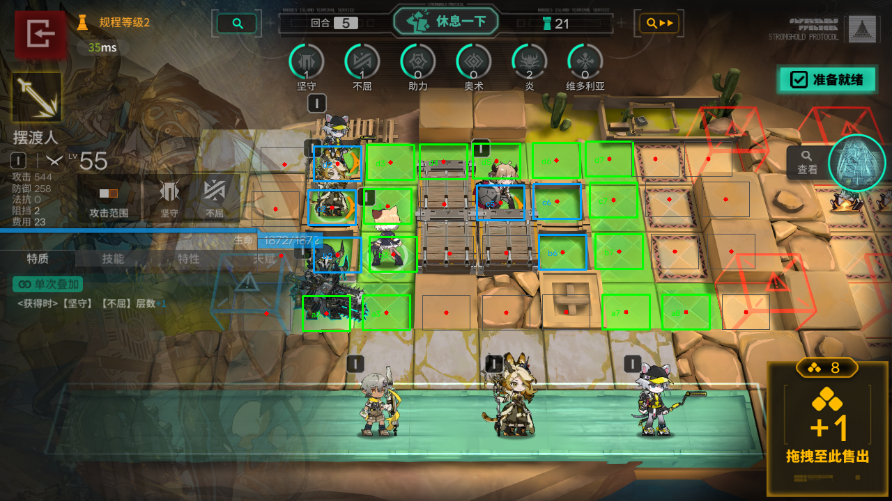

# bubble-bastion-toolkit

> 明日方舟「卫戍协议」自动化工具包 · Arknights **Stronghold Protocol** toolkit
>
> 面向 MuMu 模拟器的布阵辅助 + 从实战里抠出来的规则手册与资料库

一套用 **ADB + 本地 OCR + OpenCV** 做的明日方舟「卫戍协议·规程」单机模式操作工具，
配套一份从实战里抠出来的**规则手册 + 干员/装备/盟约资料库**。

不修改游戏、不读取内存、不注入进程，**全程只用截图和模拟触摸**，等同于人手操作。

---

## 目录

- [能做什么](#能做什么)
- [环境要求](#环境要求)
- [安装](#安装)
- [快速开始](#快速开始)
- [工具说明](#工具说明)
- [资料库](#资料库)
- [核心机制与规则（精华）](#核心机制与规则精华)
- [坐标系统](#坐标系统)
- [已知限制](#已知限制)
- [目录结构](#目录结构)
- [License](#license)

---

## 能做什么

| 功能 | 说明 |
|---|---|
| **回合开始检查** | 一条命令读出：金币 / 商店卡牌+职业 / 下一波敌人 / 商店升级费用 |
| **按网格精确放人** | 查坐标表 → 自动收起商店 → 找到干员卡 → 拖到格子中心 → 划朝向 → **点格子核对名字** |
| **可放置格识别** | 读游戏自己画的高亮格（黄绿色），像素级精确，不用猜坐标 |
| **视图校准** | 棋盘模板匹配，检测镜头有没有被拖动/缩放 |
| **回合推进** | 处理「确认准备吗」弹窗 → 等下一回合 → 报告回合数/剩余位 |
| **撤退** | 模板匹配定位撤退按钮，把放错的干员撤回来重放 |
| **OCR** | 本地 RapidOCR（onnxruntime），读游戏小字比视觉模型准 |
| **视频抽帧** | yt-dlp 下 B站视频 + cv2 抽 1080p 帧 + OCR，用来研究攻略 |

---

## 环境要求

| 项目 | 要求 |
|---|---|
| 系统 | Windows 10 / 11（脚本用 PowerShell） |
| 模拟器 | MuMu 模拟器 12（其他模拟器需改 adb 路径） |
| 游戏 | 明日方舟，分辨率 1280×720 横屏 |
| Python | 3.10+，需要 `opencv-python` `numpy` `rapidocr-onnxruntime` `yt-dlp` |
| ADB | MuMu 自带的 adb（路径见下文） |

> 全部依赖都可以离线装：`pip install -r requirements.txt`

---

## 安装

### 1. 装 Python 依赖

```bash
python -m venv .venv
.venv\Scripts\activate
pip install -r requirements.txt
```

### 2. 改路径

所有脚本顶部都有这几行，**改成你自己的路径**：

```powershell
$v   = 'E:\DSH\vision'                                    # 工具目录
$adb = 'D:\MuMu模拟器\MuMuPlayer\nx_device\12.0\shell\adb.exe'   # MuMu 的 adb
```

adb 端口会变，脚本会自动从 `adb-port.txt` 或 MuMuManager 读，也可以手动传 `-Port`。

### 3. 确认模拟器连上

```bash
adb connect 127.0.0.1:16416
adb devices
```

### 4. 多开实例（容易踩的坑）

MuMu 多开时**每个实例有自己的 adb 端口**，用的不是同一个：

| 实例 | 默认名 | adb 端口 |
|---|---|---|
| 0 | MuMu安卓设备 | 16384 |
| 1 | MuMu安卓设备-1 | 16416 |

查当前实例端口（最可靠）：

```powershell
& "D:\MuMu模拟器\MuMuPlayer\nx_main\MuMuManager.exe" info -v 1
# 看返回 JSON 里的 adb_port
```

**症状**：工具端口和 `adb-port.txt` 都指向实例 0，但游戏开在实例 1 上 →
截图是全黑的、点击没反应、`adb devices` 里那个设备 `offline`。

**修法**：把端口对齐到实际开游戏的那个实例，并确认 `adb connect` 后显示 `device` 而不是 `offline`。
另外，没有 root 的实例照样能用（`input` 权限普通 shell 就有），别为了 root 去换实例。

> 截图尺寸要以 `screencap` 出来的图为准：有的实例 `wm size` 报 720×1280（竖屏物理），
> 但方舟是横屏渲染，实际截出来是 **1280×720**，网格坐标按截图的 1280×720 算。

---

## 快速开始

```powershell
# ① 回合开始：读金币、商店、敌人、升级费用
.\tools\core\roundstart.ps1

# ② 放人：查表 → 自动收商店 → 放置 → 核对
.\tools\core\placegrid.ps1 -Unit 陨星 -Tile c6 -Face right

# ③ 准备就绪 + 等下一回合
.\tools\core\ready.ps1 -Wait 60
```

### 放人流程（强制顺序）

```
① 先收起商店（展开时会盖住棋盘，落点全错）
② 按住整备区干员卡（从卡片中心偏左按下）
③ 拖到目标格松手
④ 从格子往朝向划 400px / 1200ms
⑤ 点目标格核对面板名字
```

---

## 工具说明

### core（主力）

| 工具 | 作用 |
|---|---|
| `roundstart.ps1` | 回合开始四步检查（金币/商店/敌人/升级费用） |
| `placegrid.ps1` | 按九格网格放置，自动收商店 + 核对 |
| `tiles.py` / `tiles.ps1` | 读游戏高亮格（可放置格） |
| `viewcheck.ps1` | 视图校准（棋盘模板匹配） |
| `ready.ps1` | 准备就绪 + 弹窗确认 + 等下一回合 |
| `ocr.py` | 本地 OCR（RapidOCR） |
| `crop.ps1` / `diff.ps1` | 截图裁剪 / 差分 |
| `make_grid.py` | 生成九格网格坐标 + 覆盖图 |

### extra（辅助）

| 工具 | 作用 |
|---|---|
| `state.ps1` / `shop3.ps1` / `card.ps1` | 状态 / 商店费用 / 读卡 |
| `cov.ps1` | 盟约激活计算（按干员名单） |
| `advise.ps1` | 买卡打分建议 |
| `round.ps1` | 一整回合的串联流程 |
| `who.ps1` | 读干员名字 + 查资料库定职业 |
| `retreat` 相关 | 撤退（`retreat_icon.png` 模板匹配） |
| `place.ps1` / `place2.ps1` / `placehl.ps1` | 早期放置方案（保留参考） |
| `servo.py` | 实时视觉伺服实验（感知 3~4Hz + 控制 12Hz） |
| `vframe.py` / `vocr.ps1` | B站视频抽帧 + OCR |
| `sync-ports.ps1` | 开机同步 DSH / adb 端口 |

### build（数据构建）

| 工具 | 作用 |
|---|---|
| `build_asp_db.py` | 从原始数据生成干员/装备库 |
| `build_opdb.py` | 生成干员中文库 |
| `merge_kb.py` | 把散落的 md/json 合并成一份资料库 |
| `qdb*.py` | 查库小工具 |

---

## 资料库

`docs/02-资料库.md`（251 KB）里是整合后的全部资料：

- **十大盟约**：一图流全解 + 效果速查
- **干员**：141 条卫戍协议数据（等阶/职业/位置/攻击/阻挡/盟约/词条）+ 1437 条中文干员库
- **装备**：70 件
- **敌人**：首领 / 杂兵 / 特性
- **流派**：维多利亚(装备流) / 萨尔贡(开技能) / 乌萨斯 / 莱塔尼亚 / 谢拉格(冻结) / 伊比利亚 / 阿戈尔 / 卡西米尔 / 炎
- **经济**：通用运营 / 叠层卡与经济卡 / 远见经济倒转
- **转职装备**：变形同构体速查 + 24 件映射

数据结构见 `data/operators.json`。

---

## 核心机制与规则（精华）

> 完整版看 `docs/01-规则手册.md`

### 基本阵型

```
敌人来的方向 ←  盾位 → 战士 → 输出 → 奶  →  自己蓝门
```

d 行具体排法（右→左）：`d7 盾 → d6 战士 → d5/d4 输出 → d3 奶`

### 三条铁律

1. **输出的攻击范围必须覆盖到前排挡怪那一格**，够不到就往前挪
2. **远程不能放敌人必经之路**，没近战保护会被贴脸秒
3. **同一干员只算一个盟约人头**（特质可以重复）

### 地块

| 类型 | 特性 |
|---|---|
| 地面 | 能阻挡，会被近战/远程打 |
| 围墙 | **能放人但不阻挡**；近战敌人打不到；不免疫远程和 AOE |

### 地图结构（AC-SP-2）

- **两个红门**：d9（右上）、a9（右下）都会出兵
- **判断走哪个门**：敌人靠下=下门，靠上=上门
- **下路斜着走**：a8→a7 / b8→b7→c7 / c8→c7，**最后都汇到 d 行**
- d 行是汇合点，最该重兵把守

### 经济

- **钱每回合清零，必须花完**（除「砍诺特」策略可以留）
- **商店升级费每回合 -1，降到 0 立刻升（免费）**
- 3 个同名干员 → 自动升 2 阶 + 开免费三选一商店

### 操作禁忌

- ❌ **不要按返回键**（`keyevent 4` 会直接退出游戏）
- ❌ 商店展开状态下拖人（落点会落在商店上）
- ❌ 不核对就以为放好了

---

## 坐标系统

`data/grid-ACSP2.json` 存两套坐标：

```json
{
  "格子": { "c6": { "x": 799, "y": 289, "类型": "围墙" } },
  "千分制": { "说明": "0~1000 归一化，与分辨率无关", "格子": { "c6": { "permille": [624, 401] } } }
}
```

**千分制**换算：`像素 = permille / 1000 × 屏幕宽高`，换分辨率不用重算。

### 网格参数（透视梯形，每排不同）

| 行 | 左端 y | 右端 y | 列距 |
|---|---|---|---|
| d（红门行） | 236 | 228 | 76 |
| c | 300 | 286 | 80.75 |
| b | 367 | 361 | 80.75 |
| a（蓝门行） | 450 | 448 | 86 |

### 可放置格（19 个）

- **地面 13**：a2 a3 a7 a8 / b3 b7 / c3 c7 / d3 d4 d5 d6 d7
- **围墙 6**：b2 b6 c2 c5 c6 d2



---

## 已知限制

1. **只适配 AC-SP-2 这张图**，换图要重新标格子
2. **整备区扫描不稳**——面板没关干净时会读到旧状态，可以传 `-FromX/-FromY` 手动指定卡片位置
3. **朝向滑动偶尔失败**，参数已调到 400px/1200ms，仍可能不生效
4. **商店升级费用的数字读不出**，靠"点一下看金币掉不掉"判断
5. **不做任何游戏内修改**，纯截图+触摸，受游戏 UI 变化影响

---

## 目录结构

```
bubble-bastion-toolkit/
├── README.md
├── LICENSE
├── requirements.txt
├── .gitignore
├── docs/
│   ├── 01-规则手册.md        ← 怎么打（先读这个）
│   └── 02-资料库.md          ← 干员/装备/盟约/敌人/流派
├── data/
│   ├── operators.json        ← 141 干员 + 装备 + 盟约 + 敌人
│   └── grid-ACSP2.json       ← 网格坐标（像素 + 千分制）
├── tools/
│   ├── core/                 ← 主力工具
│   ├── extra/                ← 辅助工具
│   └── build/                ← 数据构建
└── assets/
    ├── grid-overlay.png      ← 网格覆盖图
    └── highlight-demo.jpg    ← 可放置格识别示例
```

---

## 免责声明

本项目**仅供学习与自动化技术研究**，不修改游戏文件、不读取游戏内存、不注入进程。
所有操作都是模拟人工点击/滑动，等同于玩家自己操作。
请遵守游戏用户协议，自行承担使用风险。

---

## License

[MIT](LICENSE)

---

## DSH 插件

`plugin/` 目录里是配套的 DSH 插件 **dsh-arknights-stronghold**：
装进 DeepSeek Harness 后可以直接用自然语言驱动这些工具（回合检查 / 按格放人 / 查干员 / 读高亮格）。

详见 [plugin/README.md](plugin/README.md)。
